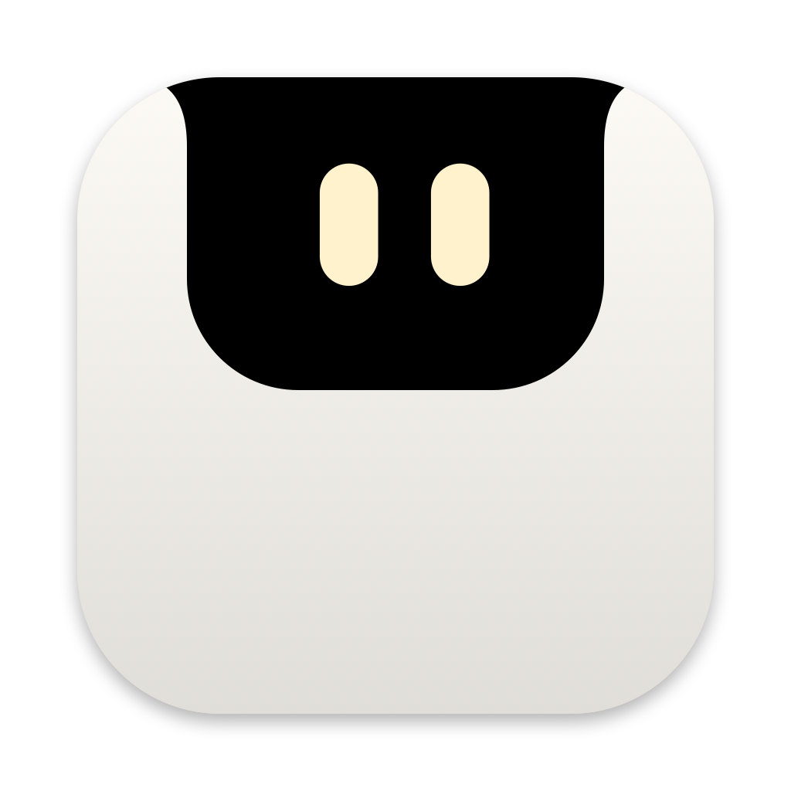

# Notchi

A little pet that lives in your Mac's menu bar. He watches your cursor, blinks, gets sleepy, reacts to downloads, notifications and your battery, and can run timers.

## Download

**[Download the latest version](https://github.com/Bakaii07/notchi-releases/releases/latest)**: open the DMG and drag Notchi into Applications.

- Apple Silicon and Intel Macs, macOS 13 Ventura or newer
- Not signed with an Apple Developer ID yet: the first time, right-click Notchi → Open (or System Settings → Privacy & Security → Open Anyway)
- Notchi updates himself: he checks here once a day (or right-click him → Check for Updates…)
